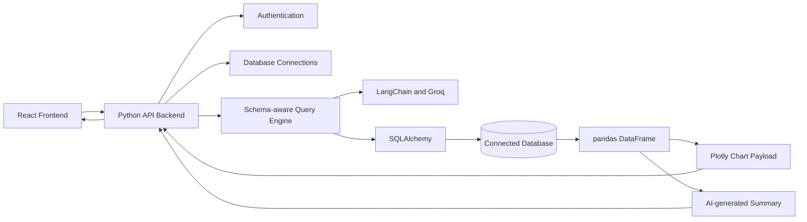

# BI CoPilot

BI CoPilot is a full-stack business intelligence assistant that lets users explore connected data by asking questions in natural language. It converts questions into SQL using database schema and conversation context, executes queries through SQLAlchemy, and presents results as tables, charts, and AI-generated explanations.

## Live Application

[Open BI CoPilot](https://bi-co-pilot.vercel.app/login)

## Repository

[Himanshu-verma121/BI_CoPilot](https://github.com/Himanshu-verma121/BI_CoPilot)

## Features

- User sign-in and registration.
- Workspace-based data exploration.
- Database connection management.
- Schema-aware natural-language-to-SQL generation.
- SQL query execution and tabular results.
- AI-generated explanations based on query results.
- Automatic chart selection and Plotly visualizations.
- Conversation context and query history for follow-up questions.
- Backend route areas for authentication, database connections, querying, alerts, and exports.
- Anomaly-detection module in the backend project structure.
- Docker Compose and Nginx configuration for container and deployment setup.

## Screenshots

### Assistant workspace


### Natural-language query workspace


### Query conversation


### Chat interface


### Sign-in page


### Line chart result


### Query output


### Bar chart result


### Database connection


### Generated query report


## Architecture



The frontend contains React views and components for chat, login, registration, and chart display. The backend organizes API routes, configuration, database models, AI query logic, anomaly detection, authentication, caching, and export utilities.

## Query Workflow

1. The user signs in and connects a database.
2. The backend reads the database schema and provides it to the query engine.
3. The user asks a question in natural language.
4. LangChain and the configured Groq model generate SQL using schema information and recent question and SQL history.
5. The backend executes the query through SQLAlchemy and converts the result into a pandas DataFrame.
6. The response can include SQL, result data, row count, answer text, chart type, and chart payload.
7. The frontend displays the answer, query details, results, and visualization.

## Technology Stack

| Area | Technologies |
|---|---|
| Frontend | React, JavaScript |
| Backend | Python ASGI application, Uvicorn |
| LLM and orchestration | LangChain, LangChain-Groq, Groq API |
| Database access | SQLAlchemy |
| Data processing | pandas |
| Visualization | Plotly |
| Container and proxy configuration | Docker, Docker Compose, Nginx |

The reviewed query-engine code configures a Groq chat model as `openai/gpt-oss-120b`. The active provider and model are determined by the backend configuration.

## Run Locally

The repository contains separate frontend and backend components. Use the current `docker-compose.yml`, backend requirements, and frontend package scripts for the exact service commands and configuration.

### Backend

From the backend directory:

```bash
pip install -r requirements.txt
uvicorn app:app --reload --host 0.0.0.0 --port 8000
```

Configure the Groq API key and required database and authentication settings through the backend environment configuration. Do not commit secret values.

### Frontend

From the frontend directory:

```bash
npm install
```

Start the frontend using the development script defined in its `package.json`.

### Docker Compose

From the directory containing `docker-compose.yml`:

```bash
docker compose up --build
```

## Security and Limitations

- Generated SQL is LLM-assisted and should be treated as untrusted input.
- The reviewed SQL safety check uses a `SELECT` prefix and string checks for dangerous words. This is not a complete SQL security boundary. Use a read-only database account and enforce permissions at the database level.
- Database credentials must never be placed in frontend code, committed files, or logs.
- Workspace isolation, connection cleanup, query timeouts, and credential handling should be verified before production use.
- Chart selection is heuristic and may choose an unsuitable visualization.
- LLM-generated SQL and summaries can be incorrect. Validate important business decisions against the underlying data.

## Development Considerations

- Verify compatible versions of LangChain, `langchain-groq`, and `langchain-core` before building the backend container.
- Add integration tests for database connections, SQL generation, query execution, and chart responses.
- Strengthen SQL validation with parser-based checks and database-level read-only permissions.
- Add query timeouts and reliable database connection lifecycle handling.
- Verify authorization for every workspace, connection, and query route.
- Document supported database engines and the environment variables required by the current source code.
